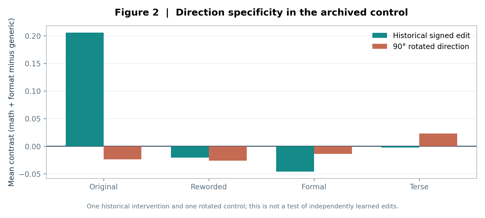
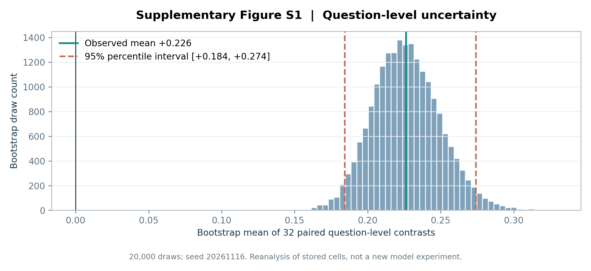

<div align="center">

<h1> Fluid Tensors</h1>

<h3>One Frozen Edit. Four Ways to Ask.</h3>

<p><strong>Open, reproducible research on prompt-conditioned transformer weight editing.</strong></p>

<p>
  <a href="https://www.python.org/"></a>
  <a href="https://numpy.org/"></a>
  <a href="https://matplotlib.org/"></a>
  <a href="https://doi.org/10.5281/zenodo.24284827"></a>
  <a href="LICENSE-MIT"></a>
  <a href="LICENSES.md"></a>
  <a href="https://github.com/Harmain11/fluid-tensors/stargazers"></a>
</p>

<p>
  <a href="https://harmain11.github.io/fluid-tensors/">Interactive Study</a> ·
  <a href="https://harmain11.github.io/fluid-tensors/papers/one-frozen-edit.html">Research Article</a> ·
  <a href="https://doi.org/10.5281/zenodo.24284827">Preprint / DOI</a> ·
  <a href="docs/REPLICATION_CHALLENGE.md">Replication challenge</a> ·
  <a href="CONTRIBUTING.md">Contributing guide</a> ·
  <a href="https://github.com/Harmain11/fluid-tensors/fork">Fork</a> ·
  <a href="https://github.com/Harmain11/fluid-tensors/issues/new">Contribute</a> ·
  <a href="mailto:harmainmughal215@gmail.com?subject=Fluid%20Tensors%20research%20collaboration">Collaborate</a> ·
  <a href="https://www.linkedin.com/in/harmain-mughal-7b1845379">LinkedIn</a>
</p>

<sub>Harmain Dastgir · Independent Researcher · November 16, 2026 · Working preprint (not peer reviewed)</sub>

</div>

---

## Contents

- [Research overview](#research-overview)
- [The primary finding](#the-primary-finding)
- [Scientific figures](#scientific-figures)
- [Reproduce the analysis](#reproduce-the-analysis)
- [Repository structure](#repository-structure)
- [Interpretation and limitations](#interpretation-and-limitations)
- [Research roadmap](#research-roadmap)
- [Publication and citation](#publication-and-citation)
- [Independent replication challenge](#independent-replication-challenge)
- [Contributing and collaboration](#contributing-and-collaboration)
- [License and transparency](#license-and-transparency)

## Research overview

**What happens when a model's weight intervention stays fixed, but the wording of its input changes?**

This study analyzes a frozen factorial experiment from a historical **Qwen2.5-1.5B** weight-editing setup. Rather than asserting broad model repair, it asks a narrower question: whether the recorded *functional attenuation response* depends on prompt wording and instruction template.

The archive contains **1,024 complete measurements** from 32 question identifiers, two historical edit directions, four wording variants, and four instruction templates. We recompute the statistical comparisons from the original archived table and publish the source data, methods, six figures, and reproducibility scripts.

| Study scope | Details |
|---|---|
| Model | Qwen2.5-1.5B, one historical editing context |
| Question units | 32 paired questions |
| Factorial panel | 2 directions × 4 wordings × 4 templates |
| Total archived cells | **1,024** |
| Reported metric | Functional **attenuation** response |
| Analysis stack | Python, NumPy, Matplotlib |
| Research website | HTML5, CSS3, vanilla JavaScript, GitHub Pages |
| Publication | [Open Zenodo preprint](https://doi.org/10.5281/zenodo.24284827) |

> **Scientific scope:** The measurements describe functional attenuation, **not mathematical answer accuracy**. This is an archival reanalysis, not an independent GPU reproduction of the original intervention. It does not demonstrate general-purpose model repair or a unique causal neural circuit.

## The primary finding

For the historically selected signed direction, we compare mean attenuation under the **math-plus-format instruction** with the **generic instruction**, using the same 32 questions for each wording condition.

| Question wording | Mean attenuation contrast | Observed pattern |
|:---|---:|:---|
| Original | **+0.205542** | Positive |
| Reworded | **−0.020673** | Small negative |
| Formal | **−0.045819** | Negative |
| Terse | **−0.002337** | Approximately zero |

The mean **question-paired original-minus-reworded** contrast was **+0.226216**, with a descriptive 95% question-bootstrap interval of **[+0.184256, +0.274149]** from 20,000 resamples. All 32 paired question-level contrasts were positive in the archived panel, although their magnitudes varied. The historical 90° rotated control direction gave a **−0.023924** contrast under original wording.

The conclusion is deliberately limited: a recorded functional effect varied substantially across prompt conditions **within one selected historical model/edit setting**. Because prompt length and token positions also changed, the study does not isolate the effect of semantics alone.

## Scientific figures

The four main figures cover wording effects, a direction control, question-level comparisons, and the complete factorial response. Click any figure for the full-size image.

| Figure 1 — Wording contrasts | Figure 2 — Direction control |
|:---:|:---:|
| [](docs/assets/figure01_wording_mean_with_ci.png) | [](docs/assets/figure02_direction_control.png) |
| Four wording-conditioned signed-edit contrasts with descriptive uncertainty. | Signed edit compared with one historical 90° rotated control. |

| Figure 3 — Question-level evidence | Figure 4 — Complete response matrix |
|:---:|:---:|
| [](docs/assets/figure03_question_level_paired_effects.png) | [](docs/assets/figure04_factorial_response_heatmaps.png) |
| The distribution of paired differences, including their variation. | Raw mean attenuation by wording and instruction template. |

### Supplementary diagnostics

| Figure S1 — Bootstrap uncertainty | Figure S2 — Prompt-length confounding |
|:---:|:---:|
| [](docs/assets/figureS1_bootstrap_distribution.png) | [](docs/assets/figureS2_prompt_token_diagnostics.png) |
| 20,000 question-level resamples of the paired mean. | The compared templates differ by 14–15 tokens; lengths were not matched. |

All six graphics are reproducible from the same checksummed source table. Their full methodological interpretation is provided in the [research article](https://harmain11.github.io/fluid-tensors/papers/one-frozen-edit.html) and [11-page manuscript](paper/One_Frozen_Edit_Study_Preprint.pdf).

## Reproduce the analysis

The archived numerical results and figures can be regenerated locally. **No GPU, API key, model download, or paid service is required for this table-level replay.**

**Requirements:** Python 3.9+, NumPy, and Matplotlib. The repository uses Python for statistical reanalysis, and dependency-free HTML/CSS/JavaScript for the research website.

### Option A — Clone and run locally

```bash
git clone https://github.com/Harmain11/fluid-tensors.git
cd fluid-tensors
python -m pip install -r requirements.txt
python reproduce_deposit.py
python make_study_figures.py
```

The scripts validate the archive's checksum and complete factorial coverage before recalculating the means, paired effects, uncertainty statistics, and figures.

### Option B — Fork or download the research

- [Fork this repository](https://github.com/Harmain11/fluid-tensors/fork) to experiment on your own branch.
- [Download the repository as ZIP](https://github.com/Harmain11/fluid-tensors/archive/refs/heads/main.zip) to inspect the source without Git.
- [Read the paper on Zenodo](https://doi.org/10.5281/zenodo.24284827) before interpreting or extending the intervention results.

If you modify the analysis, report the original archived baseline separately from any newly generated data and disclose methodological changes.

Key reproducibility files:

| File | Purpose |
|---|---|
| [`data/CI_V2_RAW_RESPONSE_GEOMETRY.csv`](data/CI_V2_RAW_RESPONSE_GEOMETRY.csv) | Archived source measurements |
| [`reproduce_deposit.py`](reproduce_deposit.py) | Numeric integrity checks and statistical replay |
| [`make_study_figures.py`](make_study_figures.py) | Regeneration of all six scientific figures |
| [`figures/FIGURE_STATISTICS.json`](figures/FIGURE_STATISTICS.json) | Machine-readable figure statistics |
| [`figures/QUESTION_LEVEL_CONTRASTS.csv`](figures/QUESTION_LEVEL_CONTRASTS.csv) | Per-question paired values |
| [`paper/One_Frozen_Edit_Study_Preprint.pdf`](paper/One_Frozen_Edit_Study_Preprint.pdf) | Complete manuscript |

**Reproducibility boundary:** These commands reproduce calculations using stored measurements. They do not recreate the original model checkpoint, edit-selection procedure, or model inference run.

## Repository structure

```text
fluid-tensors/
├── data/                 # Archived response table and derived summaries
├── figures/              # Four primary and two supplementary figures
├── paper/                # Full 11-page scientific preprint (PDF)
├── docs/                 # Interactive GitHub Pages research website
│   ├── index.html        # Interactive scientific editorial homepage
│   ├── papers/           # Full illustrated research article
│   └── assets/           # Scientific plots and branded images
├── tests/                # Data, interactivity, and website checks
├── reproduce_deposit.py  # Archived numerical reanalysis
├── make_study_figures.py # Regenerate six verified figures
├── requirements.txt      # Python dependencies
├── CITATION.cff          # GitHub citation metadata
└── README.md             # Project overview and research access
```

The interactive site is served through [GitHub Pages](https://harmain11.github.io/fluid-tensors/); it does not require an application backend or API key.

## Interpretation and limitations

1. **Response is not correctness.** Attenuation contrasts cannot be interpreted as improved mathematical reasoning accuracy.
2. **Prompt conditions are confounded.** Wording, instruction length, and token positions changed together; comparisons were not length-matched.
3. **One model/edit setting.** The analysis does not establish a result across independent model families or freshly selected edit directions.
4. **Limited direction control.** One historical rotated direction is not sufficient to identify a unique causal mechanism.
5. **Conditional uncertainty.** The bootstrap resamples 32 questions from this archived panel; it does not account for the historical choice of intervention.

A stronger follow-up would use prospectively selected edits, independently reconstructed model-side experiments, matched-length prompt controls, multiple model families, and blinded final-answer correctness scoring.

## Research roadmap

The following items are **future research directions**, not completed claims:

- [ ] Independently reproduce the model-side inference and editing procedure.
- [ ] Test independently selected edit directions across multiple open-weight models.
- [ ] Compare meaning-preserving paraphrases with token-length- and position-matched controls.
- [ ] Measure blinded final-answer correctness alongside functional attenuation.
- [ ] Evaluate stronger random-direction and activation-level causal controls.
- [ ] Invite external replication and publish a transparent comparison of confirmed and negative results.

## Publication and citation

**Dastgir, H. (2026).** *One Frozen Edit, Four Ways to Ask: Prompt-Conditioned Functional Effects in a Transformer.* Working preprint, Zenodo.  
**DOI:** [10.5281/zenodo.24284827](https://doi.org/10.5281/zenodo.24284827)

Citation metadata are also provided in [`CITATION.cff`](CITATION.cff).

### BibTeX

```bibtex
@misc{dastgir2026onefrozenedit,
  author    = {Harmain Dastgir},
  title     = {One Frozen Edit, Four Ways to Ask: Prompt-Conditioned Functional Effects in a Transformer},
  year      = {2026},
  publisher = {Zenodo},
  doi       = {10.5281/zenodo.24284827},
  url       = {https://doi.org/10.5281/zenodo.24284827},
  note      = {Working preprint; not peer reviewed}
}
```

## Independent replication challenge

We invite outside researchers to [replay the 1,024-cell archive, independently rerun model-side inference, or test stronger controls](docs/REPLICATION_CHALLENGE.md). See [CONTRIBUTING.md](CONTRIBUTING.md) for reporting standards and the [replication report template](https://github.com/Harmain11/fluid-tensors/issues/new/choose). Negative findings and reconstruction blockers are welcome. CPU-only archive checks do **not** constitute an independent model-side replication.

## Contributing and collaboration

**Harmain Dastgir**  
Independent Researcher  
**Email:** harmainmughal215@gmail.com  
**LinkedIn:** [Harmain Dastgir](https://www.linkedin.com/in/harmain-mughal-7b1845379)

The study is self-funded, with no external grant reported and no competing interests declared. Independent replication, critical evaluation, methodological discussion, and future scientific collaboration are welcome.

You can contribute by:

1. **Reporting reproducibility issues:** [open a GitHub issue](https://github.com/Harmain11/fluid-tensors/issues/new) with your environment, commands, and complete error output.
2. **Reproducing the study:** fork the repository, rerun the checksummed source-table analysis, and compare your results with the published statistics.
3. **Proposing scientific improvements:** discuss matched controls, additional models, more rigorous uncertainty estimates, or new analyses before submitting a pull request.
4. **Offering independent collaboration:** [contact the author](mailto:harmainmughal215@gmail.com?subject=Fluid%20Tensors%20research%20collaboration) for replication partnerships or future research-funding discussions.

If submitting a pull request, keep the original 1,024-cell source archive unchanged, provide reproducible instructions for every new result, and clearly distinguish new experiments from the published archival findings.

**If you find the study useful, [star the repository](https://github.com/Harmain11/fluid-tensors/stargazers).** Stars help other researchers discover the open figures, code, and data.

## License and transparency

The manuscript, original figures, and research data are available under **CC BY 4.0**; the original Python reanalysis code is provided under the **MIT License**. See [`LICENSES.md`](LICENSES.md) for the respective scopes. AI assistance used in analysis and document production is disclosed in the manuscript; responsibility for the research remains with the author.

---

**Fluid Tensors** · [Research website](https://harmain11.github.io/fluid-tensors/) · [GitHub repository](https://github.com/Harmain11/fluid-tensors) · [Zenodo DOI](https://doi.org/10.5281/zenodo.24284827) · [Contact](mailto:harmainmughal215@gmail.com) · [LinkedIn](https://www.linkedin.com/in/harmain-mughal-7b1845379)
