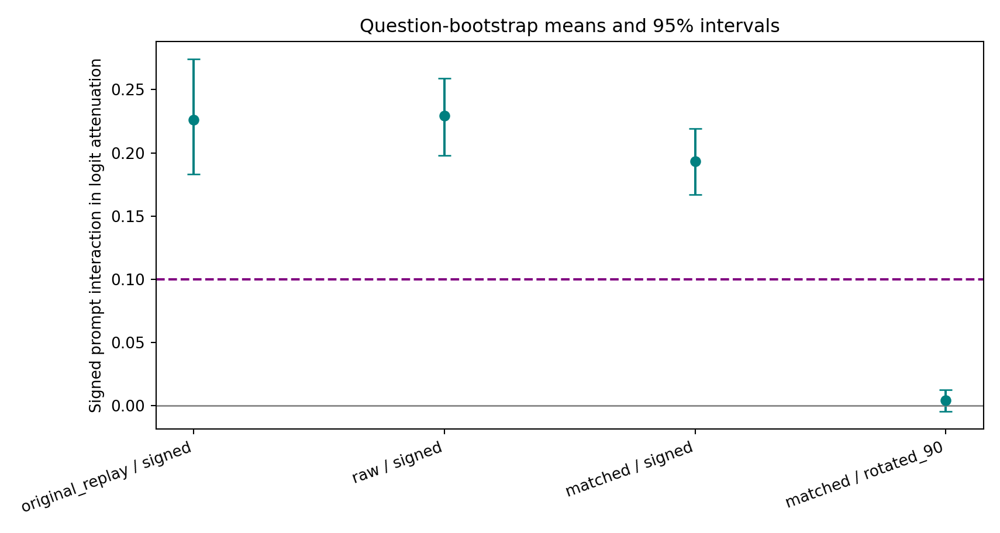
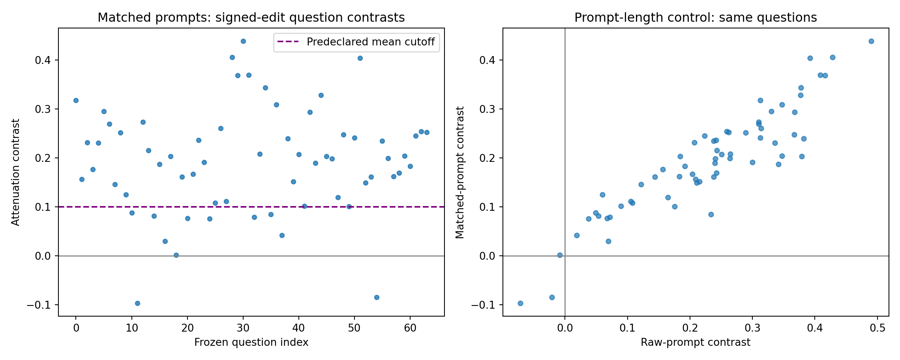
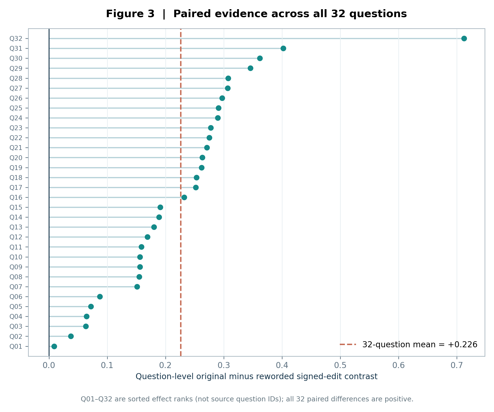

<div align="center">

<h1> Fluid Tensors</h1>

<h3>One Frozen Edit. Four Ways to Ask.</h3>

<p><strong>Paper 1 · Zenodo Version 3 · New 64-question GPU confirmation (18 November 2026)</strong></p>

<p><strong>Open, reproducible research on prompt-conditioned transformer weight editing.</strong></p>

<p>
  <a href="https://www.python.org/"></a>
  <a href="https://numpy.org/"></a>
  <a href="https://matplotlib.org/"></a>
  <a href="https://doi.org/10.5281/zenodo.24338059"></a>
  <a href="LICENSE-MIT"></a>
  <a href="LICENSES.md"></a>
  <a href="https://github.com/Harmain11/fluid-tensors/stargazers"></a>
</p>

<p>
  <a href="https://harmain11.github.io/fluid-tensors/">Interactive Study</a> ·
  <a href="https://harmain11.github.io/fluid-tensors/papers/one-frozen-edit.html">Research Article</a> ·
  <a href="https://doi.org/10.5281/zenodo.24338059">Preprint / DOI</a> ·
  <a href="docs/REPLICATION_CHALLENGE.md">Replication challenge</a> ·
  <a href="CONTRIBUTING.md">Contributing guide</a> ·
  <a href="https://github.com/Harmain11/fluid-tensors/fork">Fork</a> ·
  <a href="https://github.com/Harmain11/fluid-tensors/issues/new">Contribute</a> ·
  <a href="mailto:harmainmughal215@gmail.com?subject=Fluid%20Tensors%20research%20collaboration">Collaborate</a> ·
  <a href="https://www.linkedin.com/in/harmain-mughal-7b1845379">LinkedIn</a> ·
  <a href="https://orcid.org/0009-0004-1090-545X">ORCID</a>
</p>

<sub>Harmain Dastgir · Independent Researcher · First published November 16, 2026 · Version 3 updated November 18, 2026 · Working preprint (not peer reviewed)</sub>

</div>

---


## November 18, 2026 — Zenodo Version 3: new within-model GPU confirmation

The [Paper 1 confirmation update](paper1-confirmation-2026-11-18/README.md) adds a freshly completed **64-question within-model GPU confirmation** on the pinned Qwen2.5-1.5B-Instruct checkpoint. The specific prompt-conditioned final-token logit response contrast persisted under recorded input-token-count matching: **+0.193491** with a question-bootstrap 95% interval **[+0.166896, +0.219002]**; **62/64** fresh questions were positive. The norm-matched orthogonal control averaged **+0.004060**. The original 32-question contrast was also replayed exactly (128/128 cells), with no numeric-gate failures across all 1,152 new-run measurements.

This is **not a math-answer accuracy result**, proof of general model repair, or replication on a different model. The new GSM8K train questions were disjoint from the frozen historical registry but not necessarily from pretraining. The explicit newline-token matching is not semantically neutral. The earlier archived versions and DOI history are preserved. **The November 18 Version 3 is now published**: [DOI 10.5281/zenodo.24338059](https://doi.org/10.5281/zenodo.24338059).

- [Complete 17-page reading copy (manuscript revision v1.2, Zenodo Version 3)](paper1-confirmation-2026-11-18/One_Frozen_Edit_Paper_1_v1_2_Research_Update.pdf)
- [Supplement and independently checkable GPU evidence archive](paper1-confirmation-2026-11-18/README.md)

## Version 3 confirmation — two new research plots

These **new figures** come from the November 18 GPU run. They complement—not replace—the six original archival figures below.

| **Figure A1 · Fresh-question contrast and control** | **Figure A2 · Token-matching sensitivity** |
|:---:|:---:|
| [](docs/assets/p1_confirmation_condition_contrasts.png) | [](docs/assets/p1_confirmation_matched_vs_raw.png) |
| On 64 additional questions, the token-count-matched signed contrast was **+0.193491** (95% question-bootstrap interval **[+0.166896, +0.219002]**); the matched orthogonal control was **+0.004060** (interval crosses zero). | The same frozen intervention produced **+0.229246** under raw prompts versus **+0.193491** after the recorded newline-token matching procedure. This is a sensitivity diagnostic, not proof that semantic confounds are removed. |

| Evidence item | Recorded result | Meaning |
|---|---:|---|
| New questions | **64** GSM8K train identities | Not present in the historical question registry; pretraining exposure unknown |
| Positive paired effects | **62 / 64** | Positive sign under the selected matched comparison |
| GPU response cells | **1,152 / 1,152** | Complete cells with no numerical validation failures |
| Historical replay | **128 / 128** values matched | Verifies a bounded replay on the same pinned model/edit |
| Orthogonal control (matched) | **+0.004060** | Near-zero mean in this control, not evidence of a unique mechanism |

*These are last-token output-logit response statistics, **not** percentages or task-answer accuracies. Both plots are available at full resolution in the [research website](https://harmain11.github.io/fluid-tensors/#confirmation), the [full article](https://harmain11.github.io/fluid-tensors/papers/one-frozen-edit.html#confirmation), and the [Version 3 Zenodo record](https://zenodo.org/records/24338059).*

## Contents

- [Version 3 plots and confirmation](#version-3-confirmation--two-new-research-plots)
- [Research overview](#research-overview)
- [The primary finding](#the-primary-finding)
- [Scientific figures](#scientific-figures)
- [Reproduce the analysis](#reproduce-the-analysis)
- [Repository structure](#repository-structure)
- [Interpretation and limitations](#interpretation-and-limitations)
- [Research roadmap](#research-roadmap)
- [Publication and citation](#publication-and-citation)
- [Independent replication challenge](#independent-replication-challenge)
- [Contributing and collaboration](#contributing-and-collaboration)
- [License and transparency](#license-and-transparency)

## Research overview

**What happens when a model's weight intervention stays fixed, but the wording of its input changes?**

This study analyzes a frozen factorial experiment from a historical **Qwen2.5-1.5B** weight-editing setup. Rather than asserting broad model repair, it asks a narrower question: whether the recorded *functional attenuation response* depends on prompt wording and instruction template.

The archive contains **1,024 complete measurements** from 32 question identifiers, two historical edit directions, four wording variants, and four instruction templates. We recompute the historical statistics from the archived table and publish the original six figures. The November 18, 2026 update adds 1,152 fresh GPU response measurements, 64 additional question identities, two more figures, and an independently verifiable results bundle. The intervention and model remain the same.

| Study scope | Details |
|---|---|
| Model | Qwen2.5-1.5B-Instruct, one frozen model/edit setup |
| Original question units | 32 paired questions |
| Original factorial panel | 2 directions × 4 wordings × 4 templates |
| Original archival cells | **1,024** |
| New GPU confirmation | **64** additional GSM8K train identities; **1,152** recorded cells |
| Fresh signed matched effect | **+0.193491** [95% bootstrap interval +0.166896 to +0.219002] |
| Latest paper release | **Zenodo Version 3**; DOI 10.5281/zenodo.24338059 |
| Reported metric | Functional **attenuation** response |
| Analysis stack | Python, NumPy, Matplotlib |
| Research website | HTML5, CSS3, vanilla JavaScript, GitHub Pages |
| Publication | [Open Zenodo preprint](https://doi.org/10.5281/zenodo.24338059) |

> **Scientific scope:** The original six-figure analysis is an archival reanalysis; the separately dated follow-up performed a genuine GPU replay and new-question test **on the same pinned model/edit**. Neither phase measures math-answer correctness, independently selects a new edit, demonstrates general-purpose model repair, or replicates across model families or laboratories. Token-count matching used explicit newline-token IDs and leaves potential formatting, semantic, and positional effects.

## The primary finding

For the historically selected signed direction, we compare mean attenuation under the **math-plus-format instruction** with the **generic instruction**, using the same 32 questions for each wording condition.

| Question wording | Mean attenuation contrast | Observed pattern |
|:---|---:|:---|
| Original | **+0.205542** | Positive |
| Reworded | **−0.020673** | Small negative |
| Formal | **−0.045819** | Negative |
| Terse | **−0.002337** | Approximately zero |

The mean **question-paired original-minus-reworded** contrast was **+0.226216**, with a descriptive 95% question-bootstrap interval of **[+0.184256, +0.274149]** from 20,000 resamples. All 32 paired question-level contrasts were positive in the archived panel, although their magnitudes varied. The historical 90° rotated control direction gave a **−0.023924** contrast under original wording.

The conclusion is deliberately limited: a recorded functional effect varied substantially across prompt conditions **within one selected historical model/edit setting**. Because prompt length and token positions also changed, the study does not isolate the effect of semantics alone.

## Scientific figures

**Eight figures are now available.** The [two new Version 3 GPU plots](#version-3-confirmation--two-new-research-plots) appear near the top of this README. The six historical figures below cover wording effects, a direction control, question-level comparisons, the complete factorial response, and two diagnostic views. Click any figure for its full-size image.

| Figure 1 — Wording contrasts | Figure 2 — Direction control |
|:---:|:---:|
| [](docs/assets/figure01_wording_mean_with_ci.png) | [](docs/assets/figure02_direction_control.png) |
| Four wording-conditioned signed-edit contrasts with descriptive uncertainty. | Signed edit compared with one historical 90° rotated control. |

| Figure 3 — Question-level evidence | Figure 4 — Complete response matrix |
|:---:|:---:|
| [](docs/assets/figure03_question_level_paired_effects.png) | [](docs/assets/figure04_factorial_response_heatmaps.png) |
| The distribution of paired differences, including their variation. | Raw mean attenuation by wording and instruction template. |

### Supplementary diagnostics

| Figure S1 — Bootstrap uncertainty | Figure S2 — Prompt-length confounding |
|:---:|:---:|
| [](docs/assets/figureS1_bootstrap_distribution.png) | [](docs/assets/figureS2_prompt_token_diagnostics.png) |
| 20,000 question-level resamples of the paired mean. | The compared templates differ by 14–15 tokens; lengths were not matched. |

The **six historical figures** are reproducible from the checksummed archival table. **Figures A1 and A2** come from the separately archived November 18 GPU run and its hashed evidence. The integrated [17-page Version 3 reading copy](paper1-confirmation-2026-11-18/One_Frozen_Edit_Paper_1_v1_2_Research_Update.pdf) preserves the original manuscript pages and adds a dated scientific supplement.

## Reproduce the analysis

The archived numerical results and six original figures can be regenerated locally. The **new 1,152-cell GPU results can be audited offline** from the published ZIP. **No GPU, API key, model download, or paid service is required for either stored-data audit**. Actually repeating model inference on a GPU is a separate operation.

**Requirements:** Python 3.9+, NumPy, and Matplotlib. The repository uses Python for statistical reanalysis, and dependency-free HTML/CSS/JavaScript for the research website.

### Option A — Clone and run locally

```bash
git clone https://github.com/Harmain11/fluid-tensors.git
cd fluid-tensors
python -m pip install -r requirements.txt
python reproduce_deposit.py
python make_study_figures.py
```

The scripts validate the original archive's checksum and factorial coverage before recalculating its means, paired effects, uncertainty statistics, and six historical figures.

**To audit the Version 3 GPU run without rerunning inference:** download the [published GPU results ZIP](paper1-confirmation-2026-11-18/FT_P1_CONFIRMATION_2026_11_18_ALL_RESULTS.zip). It includes the offline checker and its companion module. With Python, NumPy and a local copy of the ZIP:

```bash
unzip FT_P1_CONFIRMATION_2026_11_18_ALL_RESULTS.zip verify_results_zip.py confirmation_core.py -d p1_audit
python p1_audit/verify_results_zip.py FT_P1_CONFIRMATION_2026_11_18_ALL_RESULTS.zip
```

*On Windows without `unzip`, extract those two named Python files using File Explorer, then run the second command.*

Expected evidence checks include a valid ZIP hash manifest, 1,152 recorded cells, an exact 128-cell historical replay, and the reported matched signed-versus-control measurements. See the [confirmation methods and limitations](paper1-confirmation-2026-11-18/README.md).

### Option B — Fork or download the research

- [Fork this repository](https://github.com/Harmain11/fluid-tensors/fork) to experiment on your own branch.
- [Download the repository as ZIP](https://github.com/Harmain11/fluid-tensors/archive/refs/heads/main.zip) to inspect the source without Git.
- [Read the paper on Zenodo](https://doi.org/10.5281/zenodo.24338059) before interpreting or extending the intervention results.

If you modify the analysis, report the original archived baseline separately from any newly generated data and disclose methodological changes.

Key reproducibility files:

| File | Purpose |
|---|---|
| [`data/CI_V2_RAW_RESPONSE_GEOMETRY.csv`](data/CI_V2_RAW_RESPONSE_GEOMETRY.csv) | Archived source measurements |
| [`reproduce_deposit.py`](reproduce_deposit.py) | Numeric integrity checks and statistical replay |
| [`make_study_figures.py`](make_study_figures.py) | Regeneration of all six scientific figures |
| [`figures/FIGURE_STATISTICS.json`](figures/FIGURE_STATISTICS.json) | Machine-readable figure statistics |
| [`figures/QUESTION_LEVEL_CONTRASTS.csv`](figures/QUESTION_LEVEL_CONTRASTS.csv) | Per-question paired values |
| [`paper/One_Frozen_Edit_Study_Preprint.pdf`](paper/One_Frozen_Edit_Study_Preprint.pdf) | Historical original preprint (preserved) |
| [`paper1-confirmation-2026-11-18/`](paper1-confirmation-2026-11-18/) | New GPU results ZIP, updated reading copy, plots, and audit materials |

**Reproducibility boundary:** These commands reproduce calculations using stored measurements. They do not recreate the original model checkpoint, edit-selection procedure, or model inference run.

## Repository structure

```text
fluid-tensors/
├── data/                 # Archived response table and derived summaries
├── figures/              # Four primary and two supplementary figures
├── paper/                # Preserved 11-page original preprint
├── paper1-confirmation-2026-11-18/ # Version 3 research update, GPU data, 17-page reading copy
├── docs/                 # Interactive GitHub Pages research website
│   ├── index.html        # Interactive scientific editorial homepage
│   ├── papers/           # Full illustrated research article
│   └── assets/           # Six original plus two confirmation plots, branded images
├── tests/                # Data, interactivity, and website checks
├── reproduce_deposit.py  # Archived numerical reanalysis
├── make_study_figures.py # Regenerate six historical verified figures
├── requirements.txt      # Python dependencies
├── CITATION.cff          # GitHub citation metadata
└── README.md             # Project overview and research access
```

The interactive site is served through [GitHub Pages](https://harmain11.github.io/fluid-tensors/); it does not require an application backend or API key.

## Interpretation and limitations

1. **Response is not correctness.** Neither the archived attenuation nor the new final-token logit response measures final-answer accuracy.
2. **Prompt and position confounds remain.** The archival prompts differed in length. The fresh run equalized token counts via explicit newline-token IDs, but this does not guarantee equivalent semantics, positions, or natural-token distributions.
3. **One frozen model/edit setting.** The 64 further questions add within-model evidence, not cross-family or external-lab replication; the intervention was not newly selected by an independent team.
4. **Question provenance.** The new identities are from GSM8K's train split, so possible pretraining exposure cannot be ruled out.
5. **Limited control and conditional intervals.** The historical rotated control and fresh norm-matched orthogonal control inform direction specificity but do not prove a unique circuit. Question-bootstrap intervals are conditional on the selected edit and evaluated questions.

A stronger follow-up would use prospectively selected edits, independently reconstructed model-side experiments, matched-length prompt controls, multiple model families, and blinded final-answer correctness scoring.

## Research roadmap

The following items are **future research directions**, not completed claims:

- [x] Replay the frozen original contrast with the same pinned model/edit on a GPU (128/128 archival values matched).
- [x] Record 64 additional question identities and a token-count-matched orthogonal control on that same model/edit (Version 3).
- [ ] Independently construct new edit directions and test across additional open-weight models.
- [ ] Compare meaning-preserving paraphrases with stronger token-length- and position-matched semantic placebos.
- [ ] Measure blinded final-answer correctness alongside functional attenuation.
- [ ] Evaluate stronger random-direction and activation-level causal controls.
- [ ] Invite external replication and publish a transparent comparison of confirmed and negative results.

## Publication and citation

**Dastgir, H. (2026).** *One Frozen Edit, Four Ways to Ask: Prompt-Conditioned Functional Effects in a Transformer.* **Zenodo Version 3** (November 18, 2026), working preprint; original manuscript plus confirmation supplement.  
**DOI:** [10.5281/zenodo.24338059](https://doi.org/10.5281/zenodo.24338059)

Citation metadata are also provided in [`CITATION.cff`](CITATION.cff).

### BibTeX

```bibtex
@misc{dastgir2026onefrozenedit,
  author    = {Harmain Dastgir},
  title     = {One Frozen Edit, Four Ways to Ask: Prompt-Conditioned Functional Effects in a Transformer},
  year      = {2026},
  publisher = {Zenodo},
  doi       = {10.5281/zenodo.24338059},
  url       = {https://doi.org/10.5281/zenodo.24338059},
  note      = {Working preprint; not peer reviewed}
}
```

## Independent replication challenge

We invite outside researchers to [replay the 1,024-cell archive, independently rerun model-side inference, or test stronger controls](docs/REPLICATION_CHALLENGE.md). See [CONTRIBUTING.md](CONTRIBUTING.md) for reporting standards and the [replication report template](https://github.com/Harmain11/fluid-tensors/issues/new/choose). Negative findings and reconstruction blockers are welcome. CPU-only archive checks do **not** constitute an independent model-side replication.

## Contributing and collaboration

**Harmain Dastgir**  
Independent Researcher  
**Email:** harmainmughal215@gmail.com  
**LinkedIn:** [Harmain Dastgir](https://www.linkedin.com/in/harmain-mughal-7b1845379)  
**ORCID:** [0009-0004-1090-545X](https://orcid.org/0009-0004-1090-545X)

The study is self-funded, with no external grant reported and no competing interests declared. Independent replication, critical evaluation, methodological discussion, and future scientific collaboration are welcome.

You can contribute by:

1. **Reporting reproducibility issues:** [open a GitHub issue](https://github.com/Harmain11/fluid-tensors/issues/new) with your environment, commands, and complete error output.
2. **Reproducing the study:** fork the repository, rerun the checksummed source-table analysis, and compare your results with the published statistics.
3. **Proposing scientific improvements:** discuss matched controls, additional models, more rigorous uncertainty estimates, or new analyses before submitting a pull request.
4. **Offering independent collaboration:** [contact the author](mailto:harmainmughal215@gmail.com?subject=Fluid%20Tensors%20research%20collaboration) for replication partnerships or future research-funding discussions.

If submitting a pull request, keep the original 1,024-cell source archive unchanged, provide reproducible instructions for every new result, and clearly distinguish new experiments from the published archival findings.

**If you find the study useful, [star the repository](https://github.com/Harmain11/fluid-tensors/stargazers).** Stars help other researchers discover the open figures, code, and data.

## License and transparency

The manuscript, original figures, and research data are available under **CC BY 4.0**; the original Python reanalysis code is provided under the **MIT License**. See [`LICENSES.md`](LICENSES.md) for the respective scopes. AI assistance used in analysis and document production is disclosed in the manuscript; responsibility for the research remains with the author.

---

**Fluid Tensors** · [Research website](https://harmain11.github.io/fluid-tensors/) · [GitHub repository](https://github.com/Harmain11/fluid-tensors) · [Zenodo DOI](https://doi.org/10.5281/zenodo.24338059) · [Contact](mailto:harmainmughal215@gmail.com) · [LinkedIn](https://www.linkedin.com/in/harmain-mughal-7b1845379)
