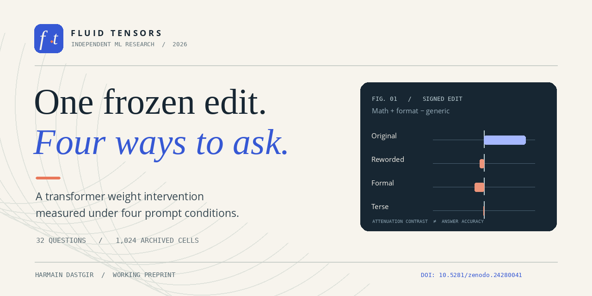
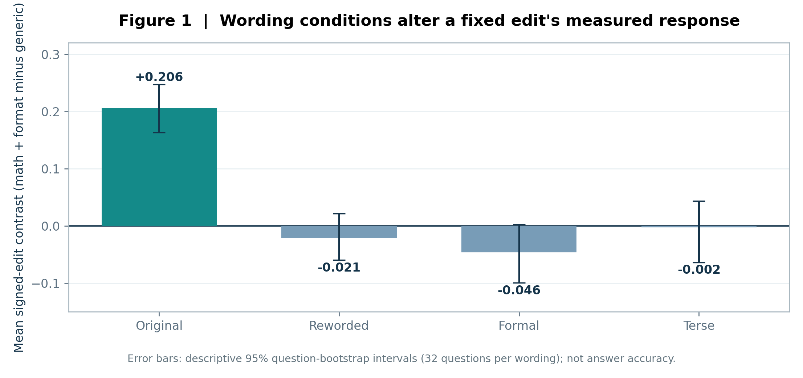
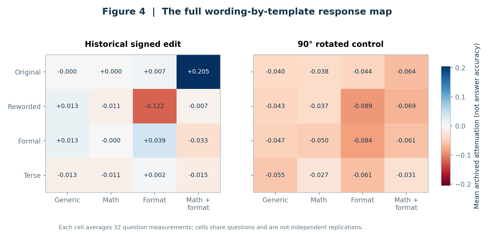
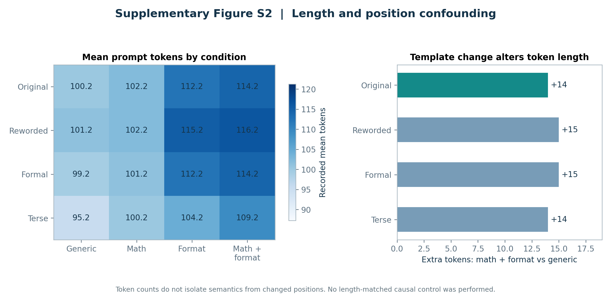

<div align="center">

<a href="https://harmain11.github.io/fluid-tensors/"></a>

# Fluid Tensors

### One frozen edit. Four ways to ask. A different measured response.

An open, reproducible scientific study of **prompt-conditioned functional effects** in a historical transformer weight-editing experiment.

**[Explore the interactive findings ↗](https://harmain11.github.io/fluid-tensors/)** &nbsp;·&nbsp; **[Read the deep-dive article ↗](https://harmain11.github.io/fluid-tensors/papers/one-frozen-edit.html)** &nbsp;·&nbsp; **[Read &amp; cite the preprint ↗](https://doi.org/10.5281/zenodo.24280041)**

Harmain Dastgir · Independent Researcher · November 16, 2026 · **Working preprint, not peer reviewed**

</div>

---

## One question that changes the interpretation

If a transformer weight edit appears to have a strong recorded functional effect, **what happens if the very same question is phrased differently?** This archival analysis compares four wording conditions against one historical intervention and publishes all six scientific plots, numeric replay scripts, and limitations.

> [!IMPORTANT]
> This repository audits *recorded attenuation*, **not math-answer correctness**. It is not an independent rerun of original model inference and does not establish general-purpose model repair or a unique causal neural circuit.

**Research correspondence:** harmainmughal215@gmail.com &nbsp;·&nbsp; **Zenodo DOI:** [10.5281/zenodo.24280041](https://doi.org/10.5281/zenodo.24280041)

> **Key boundary:** This repo reanalyzes *stored functional-response measurements*, not mathematical answer correctness or an independently rerun model. The experiment does not establish general-purpose model repair or a reliable accuracy improvement.

## The result in 30 seconds

- Fixed historical edit: one Qwen2.5-1.5B setup with signed direction and one 90° rotated direction.
- Complete factorial panel: **32 questions × 2 directions × 4 wordings × 4 instruction templates = 1,024 archived cells**.
- Signed-edit `math_format − generic` mean attenuation response: **original +0.205542**, **reworded −0.020673**, **formal −0.045819**, **terse −0.002337**.
- Question-paired original-minus-reworded: **+0.226216**; 20,000-draw question bootstrap 95% CI **[+0.184256, +0.274149]**; 32/32 positive paired contrasts in this panel. The effects range from **+0.008832 to +0.712422**, so their magnitudes vary substantially.
- Original-wording rotated-direction control: **−0.023924**.

<table><tr><td width="50%"><a href="figures/figure01_wording_mean_with_ci.png"></a><br><strong>FIG. 01 — Wording effect</strong><br>Four mean attenuation contrasts.</td><td width="50%"><a href="figures/figure02_direction_control.png"></a><br><strong>FIG. 02 — Rotated control</strong><br>One direction comparison.</td></tr><tr><td><a href="figures/figure03_question_level_paired_effects.png"></a><br><strong>FIG. 03 — Every question</strong><br>32 paired effects, not one headline bar.</td><td><a href="figures/figure04_factorial_response_heatmaps.png"></a><br><strong>FIG. 04 — Full matrix</strong><br>Raw mean attenuation, not subtracted contrast.</td></tr></table>

These numbers compare a defined *attenuation response* across prompt variants; **they cannot be interpreted as accuracy scores**. Wordings and templates differ in token length and position; the exact historical selection/training of the edit was not independently reconstructed.

## Full figure guide — four main plots, two supplemental diagnostics

All six figures are generated from the exact same checksummed 1,024-cell archived CSV. No data were invented or collected during the figure-building step.

| Plot | Research question | What it shows | Key interpretive boundary |
|---|---|---|---|
| [Figure 1](figures/figure01_wording_mean_with_ci.png) | Does the signed edit's *math-plus-format minus generic* attenuation contrast change across wording? | Four wording means, each with descriptive question-bootstrap 95% interval | The intervals condition on this selected historical edit and question panel; not an accuracy interval |
| [Figure 2](figures/figure02_direction_control.png) | Does the 90° rotated direction behave the same as the signed direction? | Both direction means under each of four wordings | One rotated control does not identify a unique circuit or independently selected edit |
| [Figure 3](figures/figure03_question_level_paired_effects.png) | Is the original-versus-reworded difference consistent across questions? | Every one of 32 paired differences; 32/32 positive, but variable magnitudes | Q01–Q32 are sorted ranks, **not source question IDs**; only 32 sampling units |
| [Figure 4](figures/figure04_factorial_response_heatmaps.png) | What does the whole two-direction × four-wording × four-template panel look like? | Two 4×4 heatmaps of **raw mean attenuation** | Heatmap colors are raw responses, **not** the difference shown in Figures 1–3 |
| [Figure S1](figures/figureS1_bootstrap_distribution.png) | How variable is the paired mean under question resampling? | 20,000 question-bootstrap mean estimates and percentile limits | Descriptive uncertainty within the archived question pool |
| [Figure S2](figures/figureS2_prompt_token_diagnostics.png) | Could the conditions change input length and token position? | Prompt-length heatmap; math-plus-format inputs are 14–15 tokens longer than generic | Strong visible confounding; no token-length-matched causal control |

The exact numerical inputs and statistical summaries underlying these plots are in [`FIGURE_STATISTICS.json`](figures/FIGURE_STATISTICS.json) and [`QUESTION_LEVEL_CONTRASTS.csv`](figures/QUESTION_LEVEL_CONTRASTS.csv). The figures are explained at greater length in the [research blog](docs/papers/one-frozen-edit.html), the [full research-study PDF](paper/One_Frozen_Edit_Study_Preprint.pdf) and [`FIGURES_README.md`](figures/FIGURES_README.md).

<details>
<summary><strong>Expand: view both supplementary scientific figures</strong></summary>

| Diagnostic | Figure | Scientific interpretation |
|---|---|---|
| Uncertainty |  | Question bootstrap describes conditional variation, not prospective editing reliability. |
| Prompt length |  | Instruction families differ by 14–15 prompt tokens; semantics and positions are confounded. |

</details>

## Recompute the archived statistics

Requires Python 3.9+, NumPy and Matplotlib. The numerical audit uses NumPy; Matplotlib is used only for the figures.

```bash
python -m pip install -r requirements.txt
python reproduce_deposit.py
python make_study_figures.py
```

No GPU, model download or API key is required. The first command validates the 1,024-cell panel and emits a JSON report with the eight mean direction/wording contrasts, paired estimate, sign statistic, source checksum and bootstrap confidence interval. The second independently checks the same raw cells and writes six PNGs, `FIGURE_STATISTICS.json` and `QUESTION_LEVEL_CONTRASTS.csv`. Both deliberately **do not** reconstruct the original model checkpoint/edit or rerun inference.

<details>
<summary><strong>Expand: scientific reproducibility boundaries</strong></summary>

The scripts replay a checksummed 1,024-cell archived source matrix and figures; they do not regenerate the original model-side data. There are 32 repeated question units rather than 1,024 independent questions. Prompt-length and position controls are absent. Replicating the model intervention requires a separately designed, independently executed experiment.

</details>

## Repository layout

```text
data/                Archived raw response-geometry CSV and derived means
figures/             Four main + two supplemental plots; source-derived stats, captions
make_study_figures.py  Recomputes figures and machine-readable figure statistics
paper/               Full research-study preprint PDF, including all six plots
docs/                Free GitHub Pages research site (HTML/CSS/vanilla JavaScript)
reproduce_deposit.py One-command numerical reanalysis
requirements.txt     Python dependencies
CITATION.cff         Live citation metadata for the published Zenodo DOI
GITHUB_ABOUT_SETUP.md GitHub social preview, repo topics and discoverability guide
```

## Interpretation and replication requirements

1. This is **one model and one historically selected edit direction**, not a prospective cross-model benchmark.
2. **32 questions**, not 1,024 statistically independent questions; bootstrap resamples the question units.
3. Prompt lengths are not matched: signed/original generic averaged ~100.25 recorded tokens and math+format ~114.25; the within-wording template difference is 14–15 tokens. Token positions may also differ.
4. The source numerical table was audited; original model-side execution was **not independently GPU-replayed** in this package.
5. The adjacent broader Fluid Tensors work includes negative/inconclusive answer-correctness and general-repair checks. This paper isolates a bounded effect rather than claiming those ambitions succeeded.

## Research feedback / collaboration

Critical replication of the model-side setup, prospective independent edit directions, matched-token-length placebo controls and correctness-based evaluation would be valuable. Feedback via GitHub Issues or email is welcome. The author is open to future scientific collaboration and potential funding discussions; that is **separate** from a formal declaration of any current competing interests.

## Citation and permissions

Suggested citation:

> Dastgir, H. (2026). *One Frozen Edit, Four Ways to Ask: Prompt-Conditioned Functional Effects in a Transformer.* Working preprint, Zenodo. DOI: [10.5281/zenodo.24280041](https://doi.org/10.5281/zenodo.24280041).

**Licenses:** The original manuscript, research blog, figures and archived numeric results use **CC BY 4.0**; the Python reanalysis code uses the **MIT License**. See [`LICENSES.md`](LICENSES.md) and [`LICENSE-MIT`](LICENSE-MIT) for exact scope and terms. The author declares no competing interests and reports self-funding. The manuscript notes AI assistance in writing, statistical analysis, figures and document preparation; the author remains responsible for the research.

