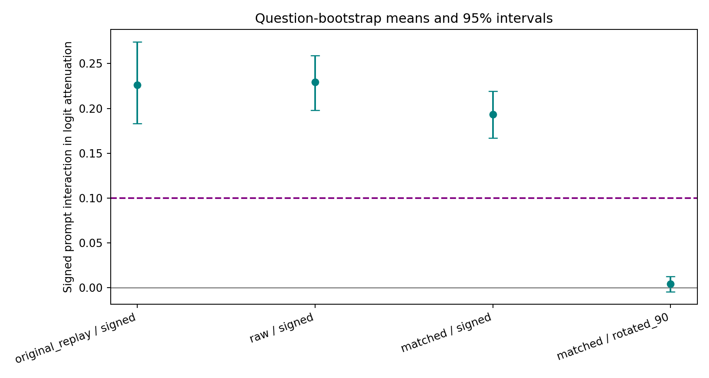
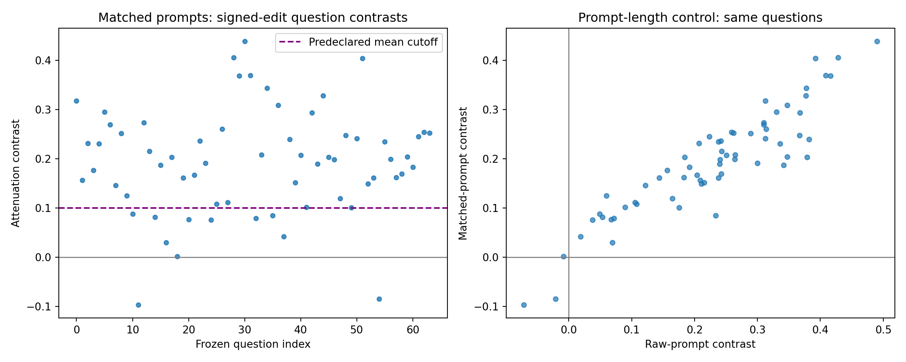

# Paper 1 — Independent-Question GPU Confirmation Addendum

**Associated publication:** *One Frozen Edit, Four Ways to Ask: Prompt-Conditioned Functional Effects in a Transformer*  
**Author:** Harmain Dastgir, Independent Researcher  
**Associated archival record:** https://zenodo.org/records/24284827  
**Confirmation analysis date:** November 18, 2026  
**Status:** Complete within-model confirmation experiment; this document is a supplementary manuscript draft, **not** a separately peer-reviewed publication.

## Abstract

We conducted an additional within-model confirmation of a previously identified prompt-conditioned response-geometry effect under a frozen low-rank modification. A pinned Qwen2.5-1.5B-Instruct checkpoint and the original rank-four, layer-19 modification were preserved. We independently replayed the preexisting primary contrast on the archived 32-question cohort, then evaluated the same contrast on 64 further GSM8K questions selected deterministically after exclusion of the frozen historical question registry. The new cohort was tested under both ordinary prompts and explicit token-count matching, alongside a norm-matched orthogonal modification. Across 1,152 completed measurement cells, all prespecified numerical reliability checks passed. On 64 token-count-matched questions, the primary signed-edit contrast averaged **0.19349**, with a question-cluster bootstrap 95% interval of **[0.16690, 0.21900]** and positive paired contrasts on **62/64 questions**. The norm-matched orthogonal control averaged **0.00406**, with interval **[−0.00461, 0.01263]**. The paired difference between signed and orthogonal contrasts averaged **0.18943**, interval **[0.16204, 0.21651]**. The result confirms the narrowly defined prompt-conditioned last-token *functional response* pattern within this frozen model/edit configuration. It does **not** establish improved task accuracy, an isolated causal circuit, unseen-model generalization, or a general-purpose repair mechanism.

## 1. Research question and scope

Does the previously observed difference in the full-strength response to a fixed model edit across mathematical prompt formats persist on additional questions when the final input token counts are matched? Is the same difference comparatively small for an equally sized edit pointing in an orthogonal parameter direction?

**Scope statement:** This is a **new-question GPU confirmation within one model**, not a fully independent cross-model or independent-laboratory replication. The same frozen edit, model revision, and software/GPU configuration were used. Claims in the associated paper must retain this distinction.

## 2. Frozen model and intervention

- Base model: `Qwen/Qwen2.5-1.5B-Instruct`.
- Model revision: `989aa7980e4cf806f80c7fef2b1adb7bc71aa306`.
- Device and runtime: NVIDIA L4 GPU; Python 3.13.16; PyTorch 2.14.1+cu130; Transformers 4.57.3; float32 model; TF32 disabled.
- Target: `model.model.layers[19].mlp.down_proj`.
- Editing mechanism: original frozen rank-four low-rank factor intervention using the archive's checkpoint and runtime hook implementation; no retraining in this study.
- Direction control: an output-factor rotation of 90 degrees with equal Frobenius norm. The recorded relative norm was **1.000000** and the inter-direction cosine **3.63 × 10⁻¹⁷**.
- Frozen base-weight digest: `56c3c552a24bfae10426abad4e538cf81497b59ea97d277e70c404d0801441e5` (SHA-256).

## 3. Question cohorts and experimental design

Two distinct sets of question identities were evaluated:

1. **Original replay cohort:** the 32 archived held-out GSM8K questions. Only the previously decisive signed-edit contrast was replayed: 2 wording variants × 2 prompt templates = **128 cells**. These were genuinely recomputed by the archived model pipeline, not used in place of new-question measurements.
2. **New cohort:** 64 deterministically selected GSM8K `train` questions whose SHA-256 identities did not overlap the 2,975 identities in the study's frozen historical exclusion list. The notebook recorded zero intersections with those excluded identities. The new cohort was tested on signed and orthogonal edit directions, original and reworded wording variants, and generic and math-format prompts: **512 raw-prompt cells** plus **512 token-count-matched cells**.

Total: **1,152 distinct recorded measurement cells**.

**Data-exposure qualification:** The new set is independent of the archived historical study identities, but it comes from the GSM8K **training** split, which may have been included in model pretraining. In addition, overlap with any later unpublished question sets not present in that archival exclusion registry cannot be ruled out without their hashes.

### Prompt-length control

For each new question, all four wording/template conditions were adjusted to have the same number of input tokens by inserting an exact number of explicit **newline token IDs immediately after the chat role header**. The original tokenizer output for each question/prompt was preserved after this padding. All 64 questions passed the token-count equality checks; 256 prompt-condition inputs were matched, requiring between 0 and 16 additional token IDs per condition.

**Interpretive qualification:** This input-level operation may produce a noncanonical byte-pair-encoding sequence. It changes formatting and model context. It equalizes the final input length; it does not guarantee semantic neutrality or eliminate every prompt-position/content/attention confound. Results should be described as *persistence under this specific token-count-matching intervention*.

## 4. Outcome and statistical analysis

The recorded measurement was **last-token logit response attenuation** relative to a centered finite-difference tangent at zero intervention. In shorthand,

\[
 A = 1 - \frac{\lVert z(1)-z(0)\rVert_2}{\lVert z'(0)\rVert_2}
\]

where \(z(s)\) is the final-token logit vector under edit strength \(s\), and the local derivative was estimated with centered steps 0.005 and 0.01. This is a response-geometry statistic, **not the correctness rate on a math task**.

For every question, the primary paired contrast was

\[
 \Delta_q = (A_{\mathrm{original,math\_format}}-A_{\mathrm{original,generic}})
 - (A_{\mathrm{reworded,math\_format}}-A_{\mathrm{reworded,generic}}).
\]

Inference used **one question as the resampling unit** with 10,000 deterministic bootstrap draws (seed 20261118). The frozen decision rule required a matched signed-edit sample mean of at least 0.10, positive lower 95% bound, complete cells, acceptable numerical diagnostics, and a matching archive replay. The matched result passes those gates.

## 5. Results

| Condition | Questions | Mean question-level contrast | 95% question-bootstrap interval | Positive question pairs |
|---|---:|---:|---:|---:|
| Original 32-question replay, signed edit | 32 | **0.226216** | [0.183103, 0.274155] | 32/32 |
| New raw prompts, signed edit | 64 | **0.229246** | [0.197980, 0.259130] | 61/64 |
| New matched prompts, signed edit **(primary)** | 64 | **0.193491** | [0.166896, 0.219002] | 62/64 |
| New matched prompts, orthogonal control | 64 | **0.004060** | [−0.004614, 0.012629] | 35/64 |
| New raw prompts, orthogonal control | 64 | **0.008959** | [−0.001434, 0.019347] | 36/64 |

Two paired secondary contrasts:

- Signed minus orthogonal direction under matched prompts: **0.189431**; 95% interval **[0.162041, 0.216506]**.
- Matched minus raw signed-edit question contrast: **−0.035755**; 95% interval **[−0.048599, −0.023462]**.

The raw-to-matched reduction is approximately **15.6%** of the raw-prompt mean. It is evidence that prompt length/formatting choices affect the measured magnitude, **not** that they fully explain the effect. The primary contrast remains positive under the particular length-matching operation evaluated.

### Numerical and provenance checks

- 1,152/1,152 expected cells present; no duplicate or nonfinite grid entries in the final audit.
- The original 128 replayed attenuation values matched their archive comparators exactly in the recorded GPU environment (maximum absolute deviation 0). This is **same-runtime reproducibility**, not external hardware/laboratory independence.
- 0/1,152 numeric-quality violations; maximum centered-tangent convergence ratio approximately **0.00334** (threshold **0.03**).
- The baseline repeat displacement was 0 in the recorded run, and layer-19 linearity diagnostics passed.
- All 26 archived file checksums in the results ZIP matched the included SHA-256 manifest.

## 6. Additional robustness analyses (post hoc; descriptive only)

The following analyses were performed **after inspecting the finished experimental results**. They are diagnostic checks, not additional preregistered hypothesis tests.

- Matched signed-edit contrast median: **0.198922**.
- Trimmed mean after dropping the six smallest and six largest question contrasts: **0.193911**.
- Leave-one-question-out mean range: **0.189599–0.198096**.
- By question text length (shortest 22 / middle 21 / longest 21 questions), the matched signed-edit means were **0.187585 / 0.212618 / 0.180552**, respectively. Each group was positive in the sample; this is not evidence of invariant effects in every text-length population.
- The matched and raw signed-edit question contrasts had Pearson correlation **0.9129**. This shows within-sample rank-order stability, not causal invariance under arbitrary formatting changes.

These checks reduce concern that the average is the result of one or two influential questions. They **cannot** resolve independent-dataset contamination, cross-model transportability, or the effects of a noncanonical padding procedure.

## 7. Interpretation, novelty, and appropriate claims

The new results strengthen the original within-model observation by adding a fixed fresh-question cohort, a measured length-matching condition, a norm-matched direction control, complete numerical checks, and a preserved audit trail. The most specific defensible conclusion is:

> A frozen rank-four intervention in Qwen2.5-1.5B-Instruct shows a reproducible prompt-conditioned difference in last-token response geometry across additional GSM8K question identities. The prespecified contrast persists under explicit input-token-count matching, while an equally sized orthogonal edit shows a much smaller contrast.

This is a **functional sensitivity finding**. It does not establish that the intervention improves model accuracy, identifies a single causal computation pathway, predicts results on other model families, or provides an operational general-purpose failure-repair system.

## 8. Study limitations and what is, and is not, resolved

| Concern | What this confirmation changes | Residual limitation |
|---|---|---|
| Limited questions in original result | Adds 64 disjoint archived-history identities | New cohort is GSM8K train; not independent of all model pretraining |
| Original result might be numerically unstable | Archive replay matched; all numerical gates passed | Same L4/software environment, not external laboratory replication |
| Finding might reflect any equal-sized weight edit | Orthogonal control is near zero | Only one fixed edit and one constructed orthogonal comparator |
| Prompt length may affect the result | Effect persists with equal input-token counts | Padding itself changes formatting/tokenization; not full isolation |
| Outlier-driven average | 62/64 matched contrasts positive; trimmed and leave-one-out means robust | Sample-level diagnostics do not prove population universality |
| Cross-model transfer | Not addressed | Requires new models and likely newly characterized interventions |
| Math reasoning improvement | Not measured | Requires answer generation and separate correctness evaluation |

## 9. Reproducibility and ethics statement

The complete evidence archive supplied with this addendum contains raw JSONL response measurements, frozen question identities, archived exact original source, the replacement confirmation source, model and checkpoint hashes, environment information, paired question-level data, plots, numeric gate results, a verifier script, and an SHA-256 manifest. The analysis did not use GSM8K gold answer fields or retrain the model in this confirmation run. No participant data or human-subject claims are involved. All model and dataset provenance and licenses should be checked against the associated original publication before public redistribution of checkpoints.

## 10. Final study decision

**Planned within-model independent-question GPU confirmation: COMPLETE.**

The notebook's prespecified primary criterion passed. For the narrowly stated Paper 1 claim, **no additional GPU run is presently required to report this study**. A cross-model, external-benchmark, or independent-laboratory replication would be a distinct expansion, not an unperformed step hidden in this protocol.

**Publication handling:** Retain the already published GitHub and Zenodo original. Add this clearly dated confirmation as a versioned supplement or related follow-up artifact after checking the existing record/repository linkage and journal-review status. Do not silently overwrite a fixed archival version or imply that these November 18 results were available at the time of the original publication.

## Figures from the archived confirmation run

{width=85%}

*Figure A1. Comparisons in the new cohort. The primary signed intervention remains positive under the recorded length matching, whereas the orthogonal direction produces a substantially smaller contrast. Bootstrap intervals resample questions, not individual factorial cells.*

{width=85%}

*Figure A2. Raw and token-count-matched inputs. The difference in magnitude is itself part of the scientific finding: the prompt matching manipulation did not leave the effect entirely unchanged.*
